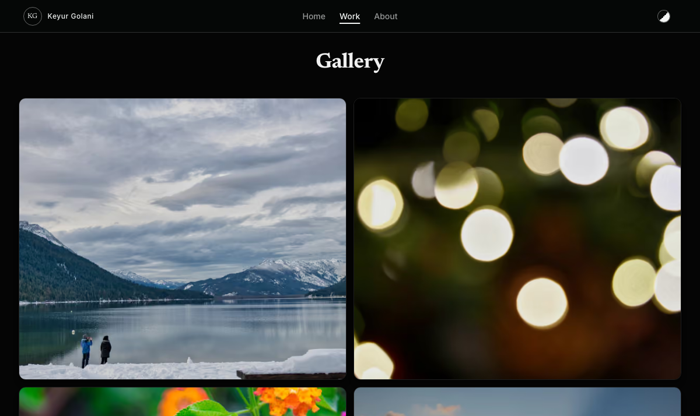

# Photography Portfolio

A modern, high-performance photography portfolio website built with Next.js 16, featuring a beautiful glassmorphism design, optimized image delivery, and seamless dark/light theme support.

**🌐 Live Demo:** [https://keyurgolani.photography/](https://keyurgolani.photography/)


> A self-hostable photography portfolio with a glassmorphism UI, masonry gallery, full-featured lightbox, dark/light theming, and an automatic Sharp-powered image pipeline (AVIF/WebP, EXIF captions).

<p align="center">
  
  
</p>

<p align="center"><em>Immersive hero carousel, masonry gallery, and lightbox viewer.</em><br/>
👉 <strong><a href="SHOWCASE.md">See the full visual showcase »</a></strong></p>

## ✨ Features

### 🎨 Design
- **Glassmorphism UI** - Modern frosted glass effects with backdrop blur
- **Dark/Light Theme** - Seamless theme switching with system preference detection
- **Responsive Design** - Optimized for all screen sizes from mobile to desktop
- **Smooth Animations** - Framer Motion powered transitions and micro-interactions
- **Auto-hiding UI** - Clean immersive viewing with context-aware UI visibility

### 🖼️ Gallery
- **Masonry Grid Layout** - Dynamic grid with best-fit image placement
- **Lightbox Viewer** - Full-featured image viewer with zoom, slideshow, and thumbnails
- **Lazy Loading** - IntersectionObserver-based lazy loading for optimal performance
- **LQIP Placeholders** - Low Quality Image Placeholders for smooth loading
- **Blur-up Effect** - Images transition from blurry to sharp as they load

### ⚡ Performance
- **Next.js Image Optimization** - Automatic AVIF/WebP format negotiation
- **Multi-size Image Pipeline** - Pre-generated thumbnails (400px), medium (800px), and full (1920px)
- **ISR Caching** - Incremental Static Regeneration for fast API responses
- **Docker Ready** - Production-optimized containerized deployment

### 🔧 Technical
- **Sharp Image Processing** - High-quality image optimization with AVIF support
- **Background Image Watcher** - Automatic processing of new photos
- **EXIF Extraction** - Automatic caption generation from photo metadata
- **Environment Variables** - Configurable carousel timing, UI timeouts, etc.

## 🚀 Quick Start

### Prerequisites
- Node.js 24 LTS (see `.nvmrc`)
- npm or yarn
- Docker (optional, for containerized deployment)

### Development

```bash
# Clone the repository
git clone https://github.com/keyurgolani/keyurgolani.photography.git
cd keyurgolani.photography

# Install dependencies
npm install

# Start development server
npm run dev

# In a second terminal, build the photos' derivatives, then keep watching for new ones
npm run images:watch
```

Open [http://localhost:3000](http://localhost:3000) to view the site. `npm run dev` alone builds no derivatives, and the Gallery lists a photo only once all seven of its derivatives exist, so it stays empty until the watcher has run. `npm run images:process` builds them once and exits.

### Development with Docker

`docker-compose.yml` runs `next dev` and the photo watcher against your checkout:

```bash
docker compose up
```

After a dependency change, rebuild with `docker compose up --build -V`. Without `-V`, the anonymous `node_modules` volume keeps the old install.

### Production with Docker

Both containers run one pinned release tag. Set it in a `.env` next to `docker-compose.prod.yml`:

```bash
PHOTOGRAPHY_IMAGE_TAG=vX.Y.Z
```

Then pull and start:

```bash
docker compose -f docker-compose.prod.yml pull
docker compose -f docker-compose.prod.yml up -d
```

[docs/releasing.md](docs/releasing.md) covers cutting a release, deploying, rollback, and telling what's running.

## 📁 Project Structure

```
├── app/                    # Next.js App Router pages
│   ├── api/               # API route for the photo list
│   ├── gallery/           # Gallery page
│   ├── about/             # About page
│   └── page.tsx           # Home page
├── components/            # React components
│   ├── Gallery.tsx        # Masonry gallery grid
│   ├── HeroCarousel.tsx   # Hero image carousel
│   ├── ThemeToggle.tsx    # Dark/light theme switcher
│   └── LoadingAnimation.tsx # Loading screen animation
├── utils/                 # Utility functions
│   ├── getImageData.ts    # Image metadata extraction
│   ├── imageOptimizer.ts  # Sharp-based image processing
│   └── watcherHandlers.ts # Watcher event handlers and job queue
├── scripts/               # Background scripts
│   ├── imageCleanup.ts    # Reviews and deletes leftover derivatives
│   └── imageWatcher.ts    # File watcher for new photos
├── public/                # Static assets
│   └── assets/photos/     # Photo storage directory
└── docker-compose.prod.yml # Production Docker configuration
```

## 🖼️ Adding Photos

1. **Drop photos** into `public/assets/photos/` directory
2. **Image watcher** automatically processes them:
   - Generates thumbnails (400px)
   - Creates medium size (800px)  
   - Optimizes full size (1920px)
   - Extracts EXIF data for captions
   - Creates LQIP placeholders
3. **Gallery updates** on the next page load once all seven of a photo's derivatives exist, and the original file is never served. The production server serves only the `public/` files that existed when it started, so restart `web` for photos added since to load there.

### Replacing and Removing Photos
- **Replace** a photo by saving over it under the same name. The watcher regenerates its derivatives from the new file and swaps them in only once all seven are written, so a failed run keeps the old ones. Visitors can still see the old version for a while: `/_next/image` can serve its copy for up to a day, and a browser that cached it under the old `immutable` header may keep it for up to a year.
- **Accepted risk:** a different photo saved under a removed photo's name, with an older modification time, shows the old images until you `touch` it or run `--force`. Copy tools that keep modification times, such as `cp -p` and `rsync -a`, do this. With the watcher stopped, run `images:cleanup` before reusing a name. The same goes for a photo added while the watcher is stopped that takes over a set another photo built, such as `IMG_1.jpg` added next to `IMG_1.png`, since the first name by path owns a shared set. A running watcher rebuilds the set when the new file arrives.
- **Delete** a photo to hide it from the gallery. Its derivative files stay reachable at their URLs until `images:cleanup` deletes them. Restoring the file brings the photo back in the gallery after `web` restarts, since Next serves only the `public/` files that existed when it started.
- **Review leftovers** with `npm run images:cleanup`. It lists each derivative no photo needs anymore, with the reason, and prints a plan hash. Re-run it with `-- --apply --plan <hash>` to delete exactly that list. It refuses if the list changed since the dry run. In production, run both steps in the watcher container:

  ```bash
  docker compose -f docker-compose.prod.yml run --rm --no-deps image-watcher npx tsx scripts/imageCleanup.ts
  docker compose -f docker-compose.prod.yml run --rm --no-deps image-watcher npx tsx scripts/imageCleanup.ts --apply --plan <hash>
  ```
- **Take a photo down** with the watcher stopped, so a job already running can't write its derivatives back:
  1. Stop `image-watcher`, then delete the photo.
  2. Run the full dry run. It also lists sets left under the photo's earlier names.
  3. Run it with `--only <name>`, where `<name>` is the photo's exact name such as `landscape`, then apply that plan. Do the same for each earlier name.
  4. Purge Next's image cache with `web` stopped, then start the stack. The purge runs inside the `web` image, since the cache files belong to its uid 1001 and a host user's `rm` can fail.
  5. Wait about two minutes, then check that `/api/photos` no longer lists the photo. Its cached list survives a restart until it revalidates.

  ```bash
  docker compose -f docker-compose.prod.yml stop image-watcher
  # Delete the photo, then:
  docker compose -f docker-compose.prod.yml run --rm --no-deps image-watcher npx tsx scripts/imageCleanup.ts
  docker compose -f docker-compose.prod.yml run --rm --no-deps image-watcher npx tsx scripts/imageCleanup.ts --only <name>
  docker compose -f docker-compose.prod.yml run --rm --no-deps image-watcher npx tsx scripts/imageCleanup.ts --only <name> --apply --plan <hash>
  docker compose -f docker-compose.prod.yml stop web
  docker compose -f docker-compose.prod.yml run --rm --no-deps web sh -c 'rm -rf /app/.next/cache/images/*'
  docker compose -f docker-compose.prod.yml start web image-watcher
  ```
- **Regenerate everything** with `npm run images:process -- --force`. In production, stop `image-watcher` first so the two never write at once:

  ```bash
  docker compose -f docker-compose.prod.yml stop image-watcher
  docker compose -f docker-compose.prod.yml run --rm --no-deps image-watcher npx tsx scripts/imageWatcher.ts --once --force
  docker compose -f docker-compose.prod.yml start image-watcher
  ```
- **Restore the library folder** if it was deleted. The watcher exits 1 when its folder disappears, and since Compose no longer creates a missing photos folder, neither container can start until it's back. Stop the stack, copy the folder back into place rather than moving it with `mv`, then start the stack.
- **Preview stable photo IDs** with `npm run photos:migrate -- --dry-run`. It proposes an ID for every photo and writes only a plan and a report, to `identity/migration/` in the data root or to `--out <dir>`. Nothing uses the IDs yet.

### Supported Formats
- JPEG (.jpg, .jpeg)
- PNG (.png)
- WebP (.webp)

## ⚙️ Configuration

### Environment Variables

| Variable | Description | Default |
|----------|-------------|---------|
| `NEXT_PUBLIC_CAROUSEL_INTERVAL` | Hero carousel slide duration (ms) | 12000 |
| `NEXT_PUBLIC_UI_AUTO_HIDE_TIMEOUT` | UI auto-hide timeout on home page (ms) | 3000 |
| `PHOTOGRAPHY_LIBRARY_DIR` | Photo library folder for the watcher, `images:cleanup`, and `/api/photos`. The site serves photos only from `public/assets/photos`, so leave it unset outside tests. | `public/assets/photos` |
| `PHOTOGRAPHY_DATA_DIR` | Private data root for photo identity state. It must sit outside `public/` and the library. Only `photos:migrate --dry-run` and `photos:identity status` read it so far. | `portfolio-data`, none in production |

### Docker Configuration

The production setup uses two containers:
- **web** - Next.js application server
- **image-watcher** - Background photo processor

| Variable | Description | Default |
|----------|-------------|---------|
| `PHOTOGRAPHY_IMAGE_TAG` | Release tag both containers run, such as `vX.Y.Z`. Set it in the `.env` next to `docker-compose.prod.yml`. | None. Compose refuses to start without it. |

See `docker-compose.prod.yml` for full configuration.

## 🎨 Customization

### Theme Colors
Edit CSS variables in `app/globals.css`:
```css
:root {
    --background-color: #FAFAFA;
    --primary-color: #121212;
    /* ... */
}

[data-theme="dark"] {
    --background-color: #050505;
    --primary-color: #F0F0F0;
    /* ... */
}
```

### Gallery Layout
Modify the grid in `components/Gallery.tsx`:
- Column count: `grid-cols-4 sm:grid-cols-8 md:grid-cols-10 lg:grid-cols-12`
- Row height: `auto-rows-[50px]`

## 📦 Tech Stack

- **Framework:** Next.js 16 (App Router)
- **Language:** TypeScript
- **Styling:** Tailwind CSS
- **Animations:** Framer Motion
- **Images:** Sharp, yet-another-react-lightbox
- **Icons:** Lucide React
- **Container:** Docker

## 📄 License

This project is open source and available under the [MIT License](LICENSE).

## 🙏 Acknowledgments

- [Next.js](https://nextjs.org/) - The React Framework
- [Sharp](https://sharp.pixelplumbing.com/) - High performance image processing
- [Framer Motion](https://www.framer.com/motion/) - Production-ready animations
- [Tailwind CSS](https://tailwindcss.com/) - Utility-first CSS framework

---

Made with ❤️ by [Keyur Golani](https://github.com/keyurgolani)