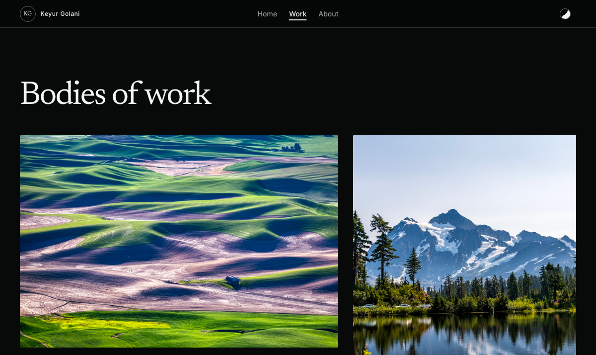
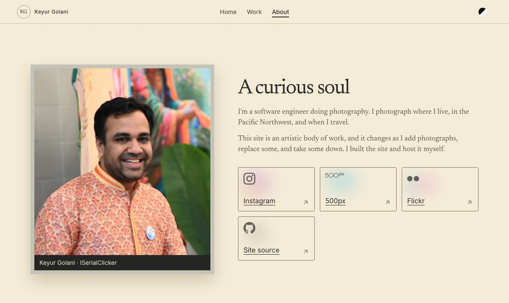

# Photography Portfolio

A modern, high-performance photography portfolio website built with Next.js 16, featuring a beautiful glassmorphism design, optimized image delivery, and seamless dark/light theme support.

**🌐 Live Demo:** [https://keyurgolani.photography/](https://keyurgolani.photography/)


> A self-hostable photography portfolio of curated series, with a story Viewer, dark/light theming, a published catalog, and an automatic Sharp-powered image pipeline (AVIF/WebP).

<p align="center">
  
  
</p>

<p align="center"><em>Home, Work, the series pages, and the story Viewer.</em><br/>
👉 <strong><a href="SHOWCASE.md">See the full visual showcase »</a></strong></p>

## ✨ Features

### 🎨 Design
- **Glassmorphism UI** - Modern frosted glass effects with backdrop blur
- **Dark/Light Theme** - Dark by default, with a light theme the site remembers once you pick it
- **Responsive Design** - Optimized for all screen sizes from mobile to desktop
- **Smooth Animations** - Framer Motion powered transitions and micro-interactions
- **Auto-hiding UI** - Clean immersive viewing with context-aware UI visibility

### 🖼️ Series
- **Work and series pages** - The bodies of work in the order the owner sets, each with its cover, statement, and sequence
- **Story Viewer** - One photograph at a time, by keyboard, touch, or zoom
- **LQIP Placeholders** - Low Quality Image Placeholders for smooth loading

### ⚡ Performance
- **Multi-size Image Pipeline** - Pre-generated AVIF and WebP sets per photo, served from `/media` at the sizes each screen asks for
- **Published Catalog** - Every page reads one published revision, which a publish or a rollback replaces with no restart
- **Docker Ready** - Production-optimized containerized deployment

### 🔧 Technical
- **Sharp Image Processing** - High-quality image optimization with AVIF support
- **Background Image Watcher** - Automatic processing of new photos
- **EXIF Extraction** - Capture dates and camera facts from photo metadata
- **Environment Variables** - Configurable UI timeouts and photo library folder

## 🚀 Quick Start

### Prerequisites
- Node.js 24 LTS (see `.nvmrc`)
- npm or yarn
- Docker (optional, for containerized deployment)

### Development

```bash
# Clone the repository
git clone https://github.com/keyurgolani/keyurgolani.photography.git
cd keyurgolani.photography

# Install dependencies
npm install

# The library has no default (v1.7.0): name it for the watcher and the CLI, as
# an absolute path outside the checkout's public/ folder, which is refused
export PHOTOGRAPHY_LIBRARY_DIR=$HOME/photography-library

# Give the library's photos their IDs, once. The dry run prints the plan to apply.
npm run photos:migrate -- --dry-run
npm run photos:migrate -- --apply --plan <plan path>

# Start development server
npm run dev

# In a second terminal, with PHOTOGRAPHY_LIBRARY_DIR set the same way, build the
# photos' /media sets, then keep watching for new ones
npm run images:watch
```

Open [http://localhost:3000](http://localhost:3000) to view the site. `npm run dev` and `npm start` listen on `127.0.0.1` only. The site shows only a published catalog revision in `./portfolio-data`, the data root the npm scripts use by default, so until one is published, Home and Work show the error page with Try again, and `/api/ready` answers 503 with `not-published`. There is no legacy photo list to fall back to (#13's slice E). The migration, the watcher, and a publish fill it: [Curating the catalog](#curating-the-catalog) below has the commands. `npm run dev` alone builds no `/media` sets; `npm run images:process` builds them once and exits. `npm run dev` reads nothing in the library, so it needs no `PHOTOGRAPHY_LIBRARY_DIR`. The watcher and the CLI exit 1 without it, naming it, rather than guess a folder, and refuse a relative path, or one inside the app's `public/` folder, where Next would serve the originals.

Outside production, `PHOTOGRAPHY_DATA_DIR` defaults to `./portfolio-data`, so the watcher here (and in the dev compose) runs with its identity watch on whether or not you set it. The identity pass itself waits until `photos:migrate --apply` initializes that folder.

### Development with Docker

`docker-compose.yml` runs `next dev` and the photo watcher against your checkout:

```bash
docker compose up
```

It listens on `127.0.0.1:3000` only. Open [http://localhost:3000](http://localhost:3000), since the dev server in the container accepts hot reload only from `localhost`. To open it from another machine, forward the port over SSH rather than publishing it wider:

```bash
ssh -N -o ExitOnForwardFailure=yes -L 127.0.0.1:3000:127.0.0.1:3000 <host>
```

After a dependency change, rebuild with `docker compose up --build -V`. Without `-V`, the anonymous `node_modules` volume keeps the old install. Both containers use `./portfolio-data` in your checkout as the data root, the same folder the npm scripts use by default. On Linux, both containers run as root, so if Compose creates `./portfolio-data` or the watcher writes it, those files belong to root with mode 0600 and the npm scripts on the host can't read them. Create the folder yourself before the first `docker compose up`, and use either the containers or the npm scripts for one data root, or `sudo chown -R "$(id -u):$(id -g)" portfolio-data` when switching to the npm scripts. Docker Desktop on macOS maps the files to your user, so this doesn't come up there.

### Production with Docker

Both containers run one pinned release tag. Set it in a `.env` next to `docker-compose.prod.yml`:

```bash
PHOTOGRAPHY_IMAGE_TAG=vX.Y.Z
```

Both also mount the private data root, `./portfolio-data`. It has to exist and belong to uid 1001 before the first start, since Compose never creates it:

```bash
mkdir -p portfolio-data
sudo chown -R 1001:1001 portfolio-data
sudo chmod 700 portfolio-data
```

The photo library stays in `./public/assets/photos` on the host. `image-watcher` alone mounts it, read-only, at `/data/library`, with `PHOTOGRAPHY_LIBRARY_DIR` pointing there, and the commands run in it read it the same way. `curator` and `web` don't mount it at all, since they read no file there, so nothing in the stack can write your originals. uid 1001 only has to be able to read them, as [Who owns the photos](docs/data-root.md#who-owns-the-photos) describes, so a file sync tool running as another user can keep owning them. [docs/data-root.md](docs/data-root.md) also covers what the data root holds, backing it up with the library, restoring it, and the one-time migration that gives every photo its ID.

About reads its portrait from the host. Put it in `./site-config/about/portrait.jpg` (or `.jpeg`, `.png`, `.webp`), with an optional `./site-config/about/portrait.json` holding its `alt` text and `focalPoint`. `web` mounts the folder read-only and reads it per request, so replacing the file changes About on the next page load, with no rebuild or restart. Home's loading screen and its badge show the same file. Without one, About shows the name in its place, and Home plays its loading screen without a portrait. Set the folder up before the first `up -d`: when it's missing, Compose creates it owned by root under a rootful daemon, and `sudo chown -R "$(id -u):$(id -g)" site-config` gives it back. [About's portrait](docs/releasing.md#abouts-portrait) has the fields, the limits, and how to swap it, `portrait.json` included:

```bash
mkdir -p site-config/about
cp ~/portrait.jpg site-config/about/portrait.jpg
chmod -R a+rX site-config
```

Then pull and start:

```bash
docker compose -f docker-compose.prod.yml pull
docker compose -f docker-compose.prod.yml up -d
```

The site listens on the host's 127.0.0.1 only, port 3000 unless `PHOTOGRAPHY_PORT` in `.env` says otherwise. A reverse proxy or tunnel on the same host serves it from there. One that runs in a container can't reach the host's 127.0.0.1, so it joins this project's network and uses `http://web:3000`, or a network alias for `web` when its origin names another host, as [docs/releasing.md](docs/releasing.md) describes for the first release with slice C of #10. The same section covers a host whose boot service runs a plain `docker compose up`, which links `docker-compose.yml` to `docker-compose.prod.yml` and names its override `docker-compose.override.yml`, and removing containers left from older service names.

Most commands in this README and in [docs/](docs/) name `-f docker-compose.prod.yml` alone, for a host with no override. On a host with one, give every command the same files the host's Compose loads: plain `docker compose` with the layout above, or `-f docker-compose.prod.yml -f <override>`. `-f docker-compose.prod.yml` alone leaves the override out, so a command run that way can mount another photos folder or data root than the site's.

[docs/releasing.md](docs/releasing.md) covers cutting a release, deploying, rollback, and telling what's running.

## 📁 Project Structure

```
├── app/                    # Next.js App Router pages
│   ├── api/               # API routes: the catalog's endpoints, health, and readiness
│   ├── work/              # Work, the series pages, and the Viewer
│   ├── about/             # About page
│   └── page.tsx           # Home page
├── components/            # React components
│   ├── home/              # Home slideshow, its controls, and playback
│   ├── ThemeMenu.tsx      # The theme menu: System, Light, Bright, Dark and Black
│   └── LoadingAnimation.tsx # Loading screen animation
├── utils/                 # Utility functions
│   ├── imageOptimizer.ts  # Sharp-based image processing
│   └── watcherHandlers.ts # Watcher event handlers and job queue
├── scripts/               # Background scripts, bundled into dist/scripts for the image
│   ├── imageWatcher.ts    # File watcher for new photos
│   ├── photos.ts          # Photo ID, identity, and catalog commands
│   └── watcherHealth.ts   # The watcher container's healthcheck
├── public/                # Static assets
│   └── assets/photos/     # Photo storage directory
└── docker-compose.prod.yml # Production Docker configuration
```

## 🖼️ Adding Photos

1. **Drop photos** into `public/assets/photos/` directory
2. **Image watcher** picks them up. It reads them, read-only, and writes only the data root: each photo's ID, and its `/media` set, WebP and AVIF from 400 px to 1920 px with an LQIP placeholder. Since v1.7.0 (#13's slice E) it writes nothing in the library, no legacy derivatives either.
3. **The curator's Inbox** shows the photo once the watcher has recorded it in the data root and built its `/media` set. It reaches the site only through a publish that places it in a series. Neither the original file nor any legacy derivative is ever served.

### Replacing and Removing Photos
- **Replace** a photo by saving over it under the same name. The watcher sees new bytes, and the curation Inbox opens a replacement item for its new `/media` set. The site serves no file from the library: `/assets/photos` answers 404, `/_next/image` refuses it, and visitors see photos only through the `/media` sets the active revision holds.
- **Delete** a photo's file and the site keeps showing it: the active catalog revision keeps listing the photo, and `/media` keeps serving it. Take it down as the next item describes.
- **The legacy derivatives** a watcher before v1.7.0 wrote, the seven folders `thumbnails`, `medium`, `optimized`, `thumbnails-avif`, `medium-avif`, `optimized-avif` and `lqip`, and `cache/`, at the top of the library, are left exactly as they are. Nothing writes, reads, or serves them, and the identity scan skips those folder names, so a photo inside them is never taken for one of yours. They harm nothing, so leave them in place: #15's GC reclaims them once it ships. No step here moves or deletes them.
- **Take a photo down** from the site: archive, then publish. `/assets/photos` never serves, so its legacy derivatives are out of reach already. Deleting, moving, or renaming the file takes nothing down by itself. The active revision keeps listing the photo, `/media` keeps serving it, and the watcher opens a `missing` item in the curation inbox. Putting the same file back closes that item. Run each command below in `image-watcher`, as `docker compose -f docker-compose.prod.yml run --rm --no-deps image-watcher node dist/scripts/photos.mjs <command>`. To take the photo down:
  1. Move its file out of the library, or delete it, and find its `missing` item with `curation list`.
  2. Run `curation archive <eventId> --version <n> --base <revisionId>`, with the version and base `curation show` prints. It takes the photo out of every series in the draft with `sequence remove` and archives it. Nothing is public yet. A publish then needs these too. Archive prints the cover, opening photograph, and chapter ones that apply, and `validate` names the rest:
     - A published series needs a cover. If the photo was the cover, the remove clears it, so pick another with `sequence cover <seriesId> <otherPhotoId>`.
     - If it was the opening photograph, the remove clears that too, and the series then has no opening photograph. Pick another with `sequence opening <seriesId> <otherPhotoId>` if you want one. A hand edit has to change or drop `openingPhotoId` itself.
     - A chapter that starts on it moves to the next photograph. If it's the chapter's only one, the remove refuses and archive writes nothing, so remove the chapter first with `sequence chapter remove <seriesId> <chapterId>`.
     - A published series needs a photograph. If it was the series' only one, hide the series: set its `visibility` to `"hidden"` with `edit <seriesId> --file <path> --expect-version <N>`, on a host copy as "Curating the catalog" below shows.
     - A hidden series can't stay featured, and at least one featured series has to stay published. If you hid a featured series, list the ones left with `series featured <seriesId>...`.
  3. Run `validate`, which names each record and field a publish would stop on, then `publish --dry-run --actor <name>`, which lists the photo under `Removed`. Then publish without `--dry-run`.
  4. Check that `GET /api/ready` answers `"state":"ok"` with the `revisionId` that publish printed. `degraded` means `web` couldn't read the new revision and still serves the one before, the photo included.
  5. Purge the photo's `/media` URLs from any CDN in front of the site. `/media` sends `max-age=31536000, immutable`, so copies already served can stay in browsers and caches for up to a year.

  Archive deletes nothing: the photo's sets stay in the data root's `assets/`. If the publish stops on errors in other records, the photo stays public until they're fixed. `validate` lists them. As a last resort, delete its sets, `assets/<photoId>/` in the data root, inside `image-watcher`. `/media` then answers 404 for them, and its page shows a broken image until a publish leaves the photo out. [docs/data-root.md](docs/data-root.md#curation-inbox) describes the other ways to settle a `missing` item, including `curation bind`, for giving a missing photo other bytes.
- **`--force`**, which rebuilt every legacy derivative, is gone with them: the watcher exits 2 on it from v1.7.0. A `/media` set is built once per photo version and never rebuilt in place.
- **An empty library at start-up**, such as a network share not mounted yet, marks nothing missing: a pass that finds no photo at all while the registry has photos present writes nothing, logs why, turns the watcher unhealthy, and tries again a minute later. `--once` exits 1 then.
- **Restore the library folder** if it was deleted. The watcher exits 1 when its folder disappears, and since Compose never creates a missing photos folder, `image-watcher` can't start until it's back. Stop the stack, copy the folder back into place rather than moving it with `mv`, then start the stack.
- **Preview stable photo IDs** with `npm run photos:migrate -- --dry-run`. It proposes an ID for every photo and writes only a plan and a report, to `identity/migration/` in the data root or to `--out <dir>`. Applying the plan with `-- --apply --plan <file>` initializes the data root, and from then on the watcher keeps the IDs current, nested folders included, and builds each photo's `/media` set. The site serves only a published catalog revision, and a publish needs the IDs, so until the plan is applied and a revision is published, `/api/ready` answers 503 with `not-published`, and Home and Work show the error page. In production, follow the runbook in [docs/data-root.md](docs/data-root.md), which backs up the library and the data root first and runs the same steps in the watcher container.
- **Check and publish the catalog** with `npm run photos -- validate`, which compiles the authored records in the data root and prints every problem without taking a lock or writing anything, so it also runs on a read-only data root, and `npm run photos -- publish --actor <name>`, which validates them again under a lock and makes the result the active revision. Add `--dry-run` to stop after validation. The first publish also needs `--confirm-launch`. From then on, the site serves the active revision, and `/media` serves only the sets it holds. "Curating the catalog" below has the rest of the commands.

### Curating the catalog

The series, their order, and each photograph's description, title, and caption live in authored records under `authored/` in the data root. The `photos` commands below edit them, `validate` checks them, and `publish` makes them public as one catalog revision. Visitors see nothing until a publish. Locally, run a command as `npm run photos -- <command>`. In production, until the image has a service of its own for these commands, run them in `image-watcher`'s container, which mounts the data root read-write, as the data-root runbook does:

```bash
photos() { docker compose -f docker-compose.prod.yml run --rm --no-deps image-watcher node dist/scripts/photos.mjs "$@"; }
photos status
```

With an override, change `docker compose -f docker-compose.prod.yml` in the function, and in the other commands here, to the files the host's Compose loads, as [Production with Docker](#production-with-docker) says.

The commands:

- `status [--json] [--check]`: the data root, the revision the site serves and whether its publish finished, the last publish, the registry's counts, the records, how many photos no series lists or have no reviewed description, the curation inbox's counts (what needs review, and the open missing, failed and ambiguous items and stale approvals, each listed, a missing source with how long it's been missing), and the watcher's heartbeat. `--check` is for a monitor: it exits 1 on an open missing, failed or ambiguous item, an inbox item it can't read, a failed last watcher pass, a watcher that has got no pass through for over 30 minutes, or a heartbeat over 5 minutes old, and prints why, and 0 otherwise. With `--json` it adds a `check` object with a code for each problem.
- `list [--unassigned] [--json]`: each photo with its library path, capture date, series, description state, and the 400 px set it would publish on. `--unassigned` keeps the photos no series lists.
- `draft:init`: a record for every photo that has none, with no description and the asset revision its file is bound to, and `site.json` if it's missing. It never overwrites a record, so run it again after adding photos.
- `carry-over [--apply --actor <name>] [--allow-missing <photoId or path>,...]`: the one-time step before the launch publish, only on a library the legacy site served (a fresh library skips it), which keeps today's photos on the site in one series, Gallery, in the legacy Gallery's order, named "Photograph N of T" as the legacy Gallery named them, with no descriptions until you write them. Without `--apply` it only prints the plan. [docs/releasing.md](docs/releasing.md#carrying-todays-photos-over) has the rest.
- `describe --import <file> [--dry-run]`: descriptions, decorative flags, titles, and captions for many photos from one file, below. `--dry-run` says what would change, takes no lock, and writes nothing.
- `sequence show | set | insert | move | remove | cover | opening | chapter add | chapter move | chapter remove`: a series' photographs, cover and its focal point, opening photograph, and chapters. `photos` with no command prints each form.
- `series order <seriesId>...` sets the Work order, and `series featured <seriesId>...` the featured series, which Home plays once it reads the catalog (#4): each load starts on one of them at random and plays through all of them, in the order given. `series featured --clear` features none, and a publish then stops on `refs.non-empty` until a published series is featured again.
- `edit <record>`: any other change to a record, below.
- `curation list | show | edit | approve | defer | dismiss | retry | reopen`: the draft inbox the watcher fills as photographs arrive, change, or go missing. `approve` places a new photograph in the draft, and nothing publishes until `publish`. A new photograph you place with `sequence set` or `insert`, or one already published, needs no judgment while a series' sequence or the live revision holds it, until its file changes: `list` counts it as already placed and leaves it out unless you pass `--all` or `--status`. `photos` with no command prints each form, and [docs/data-root.md](docs/data-root.md#curation-inbox) has the suggestion rules.
- `validate`, then `publish --actor <name>`, as above. Both refuse a change visitors would see that nobody reviewed or whose review went stale, such as a field edited by hand, or a description reviewed for bytes a replacement since changed. [docs/data-root.md](docs/data-root.md#review-state) says what makes a review stale and how to clear it.
- `diff [--json]` and `review <changeId>...`: what the next publish changes for visitors, and marking a change reviewed once you've checked it, without the curator. Below.
- `history`, `rollback` and `verify`, below.

`diff` and `review` exit as below. `status` to `series`, and `edit` below, exit 0 when they worked, 1 when they refused or the data root isn't ready or isn't set, 2 on a usage error, 3 while another command holds the authored records or when a record changed underneath it, and 4 on an I/O error. `validate` and `publish` keep slice B's codes: 0 when valid or published, 1 on validation errors, 2 on a usage error, 4 when a catalog file is damaged or an I/O error stops them, and 3 on any other stop, such as a data root that isn't ready or isn't set, a busy lock, or the first publish's launch stop. A flag given twice is refused, and an argument that starts with `-`, such as a chapter title, goes after `--`: `photos sequence chapter add <seriesId> --start <photoId> -- "-30 at dawn"`. Every `sequence` and `series` change takes `--expect-version <N>`, the version `sequence show` or the last change printed, so it stops if someone else changed the record in between.

The import file is CSV with a header row, or a JSON array of objects, with the columns `photoId` (required), `alt`, `decorative` (`true` or `false`), `title`, and `caption`. An empty cell leaves its field as it is, and an imported description counts as reviewed, so check it first. `decorative` `true` marks a photo decorative, and `false` with an empty `alt` takes the flag off, so the photo has no description and blocks a publish until it gets one. Any row the import can't apply, such as an unknown photo ID, stops the whole import before it writes anything, and a run that fails part way says how many records it wrote: running the same file again finishes it. The file has to be:

- UTF-8. In Excel, save as "CSV UTF-8": plain "CSV" and "CSV (Macintosh)" write another encoding, and the import names the first line it can't read.
- A regular file of at most 5 MiB.
- Plain text: no control characters, no invisible format characters (bidi controls, zero-width spaces, soft hyphens, tag characters, and the rest of Unicode's Cf), no private-use or unassigned code points, and no replacement characters. The import names the code point and the character's position. ZWJ and ZWNJ, the left-to-right and right-to-left marks, and emoji flags written with tags, such as England's, are fine. Chapter titles from `sequence chapter add` follow the same rules, with `title`'s 200-character limit.
- At most 1,000 characters of `alt`, 200 of `title`, and 2,000 of `caption`. Only `caption` takes a line break. The description rules still warn about alt text past 250 characters.

In JSON, a key given twice in one object keeps its last value. In production the command reads a path inside the container, so mount the file there, readable by the containers' user, for example:

```bash
docker compose -f docker-compose.prod.yml run --rm --no-deps -v "$PWD/descriptions.csv:/tmp/descriptions.csv:ro" image-watcher node dist/scripts/photos.mjs describe --import /tmp/descriptions.csv --dry-run
```

`edit (<photoId> | <seriesId> | site) [--file <path> --expect-version <N>]` covers what the commands above don't: creating a series, its slug, title, statements, and visibility, and a photo's focal point, crop, credit, and location. It opens the record's newest version in `$VISUAL` or `$EDITOR`, without the fields the commands manage (`schemaVersion`, `version`, `baseRevisionId`, `review`, and the site's `baseSeriesOrder`), checks your edit against the record's schema and its text against the import's rules and limits (statements take up to 2,000 characters and a short statement 500), and saves it as the next version. A series with no record opens as a draft, so `photos edit ser_<name>` is how a new series starts. To change a published series' slug, keep the old one in `slugAliases` in the same edit, or the publish stops ([docs/curator.md](docs/curator.md#changing-a-slug)). Its ID is `ser_` and then a lowercase letter or digit and 1 to 62 more lowercase letters, digits, `-`, or `_`. A published series also needs a title, a statement, a short statement, a photograph, and a cover before a publish takes it. The curator's **Series** screen does the same for a series' title, statements and visibility, with the same rules and the same version check ([docs/curator.md](docs/curator.md#series)). If the record changed while the editor was open, or the edit can't be saved, the command keeps your edit in `edits/` in the data root and prints the command that saves it once fixed, `edit <id> --file <path> --expect-version <N>`, where N is the version the edit started from. If the record has moved past N, that command exits 3 and names the newer version: merge your edit into it and run it again with that number. Run `photos validate` afterwards.

Opening an editor is for local use. In production, edit a host copy and save it with `--file`:

```bash
# As root, keeping the data root's owner, as docs/data-root.md's hand edits do. Say the newest version is v4.json.
root=portfolio-data
owner="$(sudo stat -c %u:%g "$root")"   # stat -f %u:%g on macOS
sudo test -e "$root/edits" || sudo install -d -o "${owner%:*}" -g "${owner#*:}" -m 700 "$root/edits"
sudo cp -n -p "$root/authored/series/<seriesId>/v4.json" "$root/edits/<seriesId>.json"
sudoedit "$root/edits/<seriesId>.json"
photos edit <seriesId> --file /data/portfolio/edits/<seriesId>.json --expect-version 4
```

The copy can keep its `stamp` and managed fields: `edit` ignores them. `--file` needs `--expect-version` whenever the record exists, so a copy can't replace a version written after it was made.

Each record is a folder of versions under `authored/`: `site/`, `series/<seriesId>/`, and `photos/<photoId>/`, each holding `v1.json`, `v2.json`, and so on, where the highest number is the record. Edit a record only through `photos edit`, or by copying its newest version to the next number and editing the copy, as [docs/data-root.md](docs/data-root.md) describes. `validate` and `publish` refuse a field visitors would see that a hand copy changed, since nothing reviewed it, so make a change you mean to publish with `photos edit`. For a hand copy:

- Only while no `photos` command runs and the curator is stopped (`docker compose -f docker-compose.prod.yml stop curator`). The commands and the curator's Inbox and Publish screen hold a lock while they write, and an editor doesn't take it.
- Never edit a version in place. A command that reads an edited newest version refuses it and names the copy that keeps the edit.
- Never copy or edit the active pointer, `catalog/active/`. Only `photos publish` and `photos rollback` move it.
- Copy and edit as root, keeping the owner: `sudo cp -n -p` keeps the owner and mode of the version it copies, and `sudoedit` writes back into the same file. A copy root owns can't be read by the app. If one already is, give it the owner of the version it came from with `chown --reference`, or `chown -R 1001:1001 ./portfolio-data/authored`, the uid `docker-compose.prod.yml` runs the app as.

The first publish is the launch, so it stops and prints how many photographs it puts on the site, with a checklist, until it's run with `--confirm-launch`. Run it again with the `--confirm-launch --expect <candidateId>` it prints, so it publishes exactly the candidate you checked. Before that:

- `photos carry-over` has run, if the site should keep the photos the legacy Gallery listed. Without it, every one of them that no series of yours holds is left out of the launch.
- A preview looks right. Copy the data root and the library, publish the copy with `PHOTOGRAPHY_DATA_DIR` pointing at it, and serve it on another port bound to `127.0.0.1`. It's the copy's first publish, so it needs `--confirm-launch` too: check that the command names the copy before you type it.
  - On a source checkout, run `npm run build`, copy `public` into `.next/standalone/public` and `.next/static` into `.next/standalone/.next/static` as the Dockerfile does, and start `node .next/standalone/server.js` with `HOSTNAME=127.0.0.1`, `PORT=3001`, and `PHOTOGRAPHY_DATA_DIR` and `PHOTOGRAPHY_LIBRARY_DIR` set to the copies' absolute paths, since `server.js` changes to its own folder. Not `npx next start`.
  - On a host that runs only the image, which has no npx or tsx, use a separate container, never the compose services. `image-watcher` mounts the real data root, so a `publish --confirm-launch` there launches production. Mount the data root copy at `/data/preview` with `-e PHOTOGRAPHY_DATA_DIR=/data/preview`, mount the library copy read-only at `/data/library` with `-e PHOTOGRAPHY_LIBRARY_DIR=/data/library`, and publish only `127.0.0.1:3001:3000`. Publish the copy in that same kind of container, with `node dist/scripts/photos.mjs publish`.

#### Reviewing what a publish changes

`photos diff` prints what publishing the draft would change for visitors, against the live revision: the Publish screen's ledger, in its groups (Authored, Derived, Source health), one row per change. Each row has its change ID, its kind, its review state and one line about it. An authored or route row shows its value before and after, with text over 200 characters cut and its full length given. A row that waits on a review says why under it, and either the `photos review` command that clears it or what clears it instead. The first lines give the candidate ID and the live revision. It takes no lock and writes nothing.

`--json` prints the same rows as one object, `{ schemaVersion: 1, candidateId, activeRevisionId, activeRevisionNumber, empty, rows }`. Each row has `id`, `group` (`authored`, `derived` or `health`), `record` (`kind` and `id`), `field`, `category`, `before`, `after`, `fields` and `causedBy` where they apply, `visible`, `surfaces`, `provenance`, `review` (its `state`, and each field it rests on with its `record`, `field`, `state`, `reason` and `detail`), `stale`, `summary`, `reviewable` (whether `photos review` can mark it), `reason` (why not, or null), and `sharedWith` (the rows marked with it). A new field keeps `schemaVersion` at 1; one that goes or changes meaning moves it on.

`photos review <changeId>... --expect <candidateId> --expect-active <revisionId | none> --actor <name>` marks rows reviewed once you've checked them, as the Publish screen's **Mark reviewed** and **Still right, mark reviewed** do, through the same code. Use it for a review that went stale (a rollback published the field differently, or the photograph got new bytes) or a change made by hand, when the value is still right:

```bash
photos diff
photos review ac623795a52b1646 --expect rev_<candidate> --expect-active rev_<live> --actor <name>
photos diff
```

- `--expect` and `--expect-active` are the candidate and the live revision `photos diff` printed. If the draft or the live revision changed since, it writes nothing and exits 3: run `photos diff` again and check what changed.
- It stamps each field a row waits on with the value the draft holds, against the live revision. It writes no value and publishes nothing, and the candidate stays the same, so `publish --expect` still takes it.
- It refuses a suggested description (write the one you want with `photos edit`), a row whose Inbox item needs a decision again (decide it with `curation`), and a field a restore left in conflict (settle it with `photos edit`). If any row named can't be marked, it writes nothing and exits 1.
- Name each row. There is no `--all`, so a publish never goes out on rows nobody looked at. Rows that rest on one stamp are marked together: two moves in one series share its order's stamp, and so does a new photograph placed in it. `photos review` refuses one of them until every one is named, and lists the IDs it also needs. `photos diff` puts them all in the row's command.
- It checks every record under one hold on the authored lock before it writes any, so a refusal, a record that moved since `photos diff`, or a busy lock writes nothing. Only an I/O error part way through the writes can leave some records marked. It then names the records it was writing, and `photos diff` shows which got marked.
- It exits 0 when it marked the rows or there was nothing left to mark, 1 when a row can't be marked here, 2 on a usage error, 3 when the draft, the live revision or a record moved, the authored lock stays busy, or the data root isn't ready, and 4 for I/O. `diff` exits 0 once it reads the catalog, 3 when the data root isn't ready, and 4 when a catalog file is damaged.

#### History and rollback

Every publish and rollback adds an activation record under `catalog/activations/`. Nothing rewrites a revision file, and a record changes only once, from pending to committed or set aside. `photos history` lists them, oldest first, by their sequence number rather than their time, since the containers' clocks can disagree. Each row has the revision number and ID, publish or rollback, who ran it and why, when, the validation result, and what that revision changed against the one it was compiled on. The live one says `LIVE`. One that never moved the active pointer, because a command crashed or lost its lock, says interrupted, and the next publish or rollback sets it aside. It takes no lock and writes nothing.

`photos rollback --to <number | revisionId> --reason <text>` makes a revision that was live before live again, without rebuilding any image:

```bash
photos history
photos rollback --to 3 --reason "revert the caption change" --actor <name>
```

- The target is a revision number or ID from `history`, and only one that was live before. The rollback is a new activation that keeps the target's number, so `history` shows revision 3 live again from a later row. No rollback goes back to the legacy Home and Gallery, and right after the launch there is no earlier revision to go to, so [docs/releasing.md](docs/releasing.md#after-the-catalog-launch) says how to go back then.
- It runs every rule on the stored revision first. An integrity error stops it, such as a derivative that is missing or has the wrong size, or a privacy rule: a rollback never brings back a path, a source file's name, or GPS, serial, or owner fields. An editorial error, today the accent color's format (`accent.format`) or contrast (`accent.contrast`), or an address change across a slug rename (`route.slug-change`, `route.alias-reassigned`, [docs/curator.md](docs/curator.md#changing-a-slug)), comes back only when you accept it: add `--accept <ruleId>` once for each rule the plan flags, such as `--accept accent.contrast`. The plan marks each one accepted or not, and without an accept for every one the rollback stops before it asks, exits 1, and changes nothing. The activation records exactly the rules it accepted, and `history` prints them. An `--accept` for a rule that isn't flagged gets a note and changes nothing; one that isn't an editorial rule's ID is a usage error. `--accept` is the one flag you can give more than once.
- It prints what the target brings back, removes, and changes against the live revision, by series and photo. A rollback can bring back a photo a later publish took out on purpose, so read the list. If the live revision's file is damaged or missing, it says so and lists everything the target publishes instead, since moving off a broken revision is what a rollback is for. The working layer can't be compared with a revision that can't be read, so after such a rollback every field that differs from the target becomes a conflict to settle before the next publish, even one you never touched. The rollback says how many it raised and lists them. Then it asks you to type `yes`. Where there is no terminal to ask in, run it again with `--yes --expect-active <revisionId>`, the live revision the list was made against, as it prints. `--yes` works only with `--expect-active`, and either way the rollback stops, changing nothing, if another revision went live in between.
- The actor is `--actor` or `PHOTOS_ACTOR`, and one is required: the container's user is always `nextjs`.
- It waits up to 30 seconds for a publish or another rollback that holds the catalog lock, then names the holder and when its lease runs out. It takes over a lease only once that lease has expired, and records the takeover on the activation. No flag breaks a live lock.
- Afterwards it moves the working layer onto the target, as a publish does. After `photos rollback`, the draft matches the target, apart from edits never published, which stay. A field the rolled-away revision published goes back to the target's value, and a series only it published goes hidden and keeps its text and photos. A field changed on both sides becomes a conflict to settle before the next publish. An inbox item approved into a series whose photo list goes back to the target's still reads `approved`, and its photo stays in the draft, unassigned. `curation list` shows the item as approved but no longer placed, without `--all`, and `curation show` prints the `curation reopen` and `curation approve --series` commands that put the photo back into its series, at the end. If the working layer is busy, or the command stops after the pointer moved, running the same rollback again finishes the job, and so does the next publish. A rollback to the revision that is already live changes nothing visitors see, so it asks nothing, and only records an interrupted activation and rebases the working layer if a crash left either undone.

`history` exits 0, 3 when the data root isn't ready or isn't set, and 4 when a catalog file is damaged or can't be read. `rollback` exits 0 when rolled back or when the target is already live, 1 when the target was never live, a rule stops it, or an editorial error isn't accepted, 2 on a usage error, 4 when a catalog file is damaged or an I/O error stops it, and 3 on any other stop: no confirmation, another revision live first, a busy lock, or a data root that isn't ready.

In production both run in `image-watcher`'s container like the other commands. `docker compose run` gives the command a terminal, so the `photos` function above can answer the confirmation. In a script, add `-T` and confirm with `--yes --expect-active`, plus an `--accept` for each editorial rule the plan flags:

```bash
docker compose -f docker-compose.prod.yml run --rm --no-deps image-watcher node dist/scripts/photos.mjs history
docker compose -f docker-compose.prod.yml run --rm --no-deps -T -e PHOTOS_ACTOR=<name> image-watcher node dist/scripts/photos.mjs rollback --to 3 --reason "revert the caption change" --yes --expect-active <revisionId> --accept <ruleId>
```

#### Verify

`photos verify` checks the catalog the way a restore needs it. For every revision file, and every revision an activation names, it checks that the file parses and hashes to its name, and that every rule passes on it: an integrity error fails the revision, and an editorial one, which a rollback can accept, only warns. The two route rules a rename trips depend on which revision is live, so verify doesn't run them. Then it checks every `/media` set the revision publishes: each file its manifest lists is there, at its size, with its SHA-256. A set that several revisions share is hashed once. Last it checks the chain: the active pointer names an activation record for its revision, every earlier activation a record names exists, and committed activations have a pointer. It prints one line per revision, oldest first, says whether a rollback can return to it, and names the fix for anything that fails, such as the set folder to put back from your archive. It reads the data root only, never the library, takes no lock, and runs only when you run it: nothing runs it on a schedule or after a publish.

```bash
photos verify
photos verify --revision <revisionId>   # one revision, recorded nowhere
photos verify --json
```

A full run records its result in `status/verify.json`, which the curator's Publish screen reads for its rollback-ready line ([docs/curator.md](docs/curator.md)). `--revision` checks one revision without the chain and writes nothing, so it can't replace a recorded failure. If the data root can't be written, it says so, and the exit code stays what the checks say. It exits 0 when the live revision and the chain pass, even if an older revision fails, 1 when either fails, 2 on a usage error, 3 when the data root isn't ready, and 4 when the registry or an activation record can't be read, or an I/O error stops it. Run it after a restore ([docs/data-root.md](docs/data-root.md#restoring)) and after upgrading, in the watcher's container as below, not as root on the host: there it runs as uid 1001, the data root's owner, so the curator can read the record. Run as root anyway, it gives the record the data root's owner. It refuses a set folder or a file in one that is a symlink, as `/media` does, without reading through it. It reads every set, so it takes a while on a large library:

```bash
docker compose -f docker-compose.prod.yml run --rm --no-deps image-watcher node dist/scripts/photos.mjs verify
```

#### Cleanup

`photos gc` plans the cleanup the data root's [retention rules](docs/data-root.md#retention-and-cleanup) allow: staging folders a killed derivative build left, and candidates that never became a revision, once each has gone unchanged for more than 7 days. It lists each path with its class, the rule that allows it, and its size, prints a plan digest, and deletes nothing. `photos gc --apply <planDigest>` deletes exactly that plan, and stops without deleting anything if the plan changed since. It never deletes an asset, a revision, an activation, a record, or anything in `edits/`.

### Supported Formats
- JPEG (.jpg, .jpeg)
- PNG (.png)
- WebP (.webp)

## ⚙️ Configuration

### Environment Variables

| Variable | Description | Default |
|----------|-------------|---------|
| `SITE_URL` | The site's public origin, like `https://keyurgolani.photography`, for share links and the share image URL. Read on every request, never at build time. Unset or invalid, share links point at `http://localhost:3000`, and a production server logs one warning at startup that names the reason, never the value. | none |
| `PHOTOGRAPHY_LIBRARY_DIR` | The photo library, the originals, for the watcher and the CLI, which only ever read it. No default since v1.7.0 (#13's slice E): unset, relative, or at or inside the app's `public/` folder, the watcher and every command that reads the library exit 1 and name it, rather than read some other folder. Both compose files mount `./public/assets/photos` read-only at `/data/library` in `image-watcher` and set it there. `curator` sets it too, only to keep the path out of its messages, and mounts nothing there. `web` reads nothing in the library, so it mounts none and needs none. | none |
| `PHOTOGRAPHY_SITE_CONFIG_DIR` | The site config folder, which holds About's portrait as `about/portrait.jpg` (or `.jpeg`, `.png`, `.webp`) and its optional `about/portrait.json`. Read per request, never at build time, and never written. It must sit outside `public/` and the library. `docker-compose.prod.yml` mounts `./site-config` read-only at `/config/site` and sets it there. See [About's portrait](docs/releasing.md#abouts-portrait). | `site-config` |
| `PHOTOGRAPHY_DATA_DIR` | Private data root for photo identity state and the `/media` sets. It must sit outside `public/` and the library, on a filesystem that supports hard links (not exFAT or FAT), since each version of its documents is written with `link()`. The watcher's identity step runs only once `photos:migrate --apply` has initialized it, and until then the watcher logs why once. Outside production it defaults to `./portfolio-data`, so `npm run images:watch` and the dev compose watch with identity on (every depth, polled) even when it's unset. In production the watcher exits 1 until it's set, since it writes nothing else. Both compose files set it to `/data/portfolio` and mount `./portfolio-data` there. To edit a document there by hand, copy its newest version to the next number without changing its owner or mode: from a shell in the watcher's image when it runs in the containers, or as root with `sudo cp -n -p` otherwise. Edit the copy, and do it only while no command runs and the curator is stopped. Never edit a version in place. [`docs/data-root.md`](docs/data-root.md) has the steps. | `portfolio-data`, none in production |

The Home slideshow interval isn't configurable. It's `HOME_AUTO_ADVANCE_MS` (12000 ms) in `components/home/homePlayback.ts`.

Neither is how long Home's chrome stays up after the last activity. It's `HOME_CHROME_IDLE_MS` (4000 ms) in `components/home/homeChromeConfig.ts`.

### Docker Configuration

The production setup uses two containers, which both mount the photos folder and the data root, `./portfolio-data`, and never create either one:
- **web** - Next.js application server. Its healthcheck calls `/api/health`, which answers 200 with the data root's state. `/api/ready` says whether the photos can be served, and from which catalog revision, and answers 503 when they can't, with `not-published` until the first publish.
- **image-watcher** - Background photo processor, run from the bundled `dist/scripts/imageWatcher.mjs`. Its healthcheck passes while the heartbeat it writes to the data root every 30 s is under 120 s old.

A third, **curator**, is off unless you start it by name. It serves the private curation pages on the host's `127.0.0.1:3001` only, and from another machine you reach it through an SSH tunnel, `ssh -L 3001:127.0.0.1:3001 <host>`, then sign in with the passphrase you set when you deployed it. [docs/curator.md](docs/curator.md) covers who can reach it, making and rotating the login credential, turning it on and off, and its settings.

| Variable | Description | Default |
|----------|-------------|---------|
| `PHOTOGRAPHY_IMAGE_TAG` | Release tag both containers run, such as `vX.Y.Z`. Set it in the `.env` next to `docker-compose.prod.yml`. | None. Compose refuses to start without it. |

See `docker-compose.prod.yml` for full configuration.

## 🎨 Customization

### Theme Colors
Edit CSS variables in `app/globals.css`:
```css
:root {
    --background-color: #FAFAFA;
    --primary-color: #121212;
    /* ... */
}

[data-theme="dark"] {
    --background-color: #050505;
    --primary-color: #F0F0F0;
    /* ... */
}
```

## 📦 Tech Stack

- **Framework:** Next.js 16 (App Router)
- **Language:** TypeScript
- **Styling:** Tailwind CSS
- **Animations:** Framer Motion
- **Images:** Sharp
- **Icons:** Lucide React
- **Container:** Docker

## 📄 License

This project is open source and available under the [MIT License](LICENSE).

## 🙏 Acknowledgments

- [Next.js](https://nextjs.org/) - The React Framework
- [Sharp](https://sharp.pixelplumbing.com/) - High performance image processing
- [Framer Motion](https://www.framer.com/motion/) - Production-ready animations
- [Tailwind CSS](https://tailwindcss.com/) - Utility-first CSS framework

---

Made with ❤️ by [Keyur Golani](https://github.com/keyurgolani)