# Showcase

A tour of the site as it's live at v1.3.0, with the catalog launched. The photographs hang as bodies of work now: ten series, 115 photographs. Each series has its own page with a statement and a sequence, and any photograph in it opens in the story Viewer. Home plays one series, Work lists them all, and About says who took them.

---

## Themes

The theme menu, top right on every page, has five choices:

- **System** follows the device, Light or Dark.
- **Light**: soft paper, with the prints matted.
- **Bright**: a white wall, with the prints framed.
- **Dark**: the site as it looked before v1.3.0.
- **Black**: pure black, nothing but the photograph.

The browser keeps the choice, and every page paints in it from the first frame, so there's no flash on load. Without JavaScript the site is Dark and the menu is hidden, since nothing in it could work.

**Work in Light, Bright, Dark and Black**

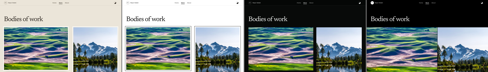

**A series page in Light, Bright, Dark and Black**

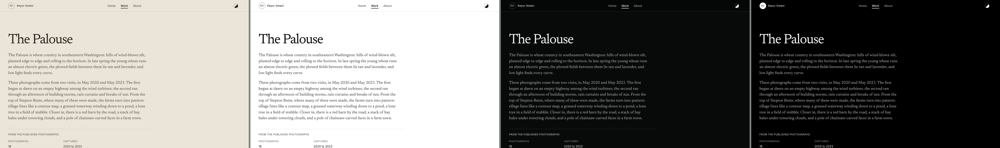

**About in Light, Bright, Dark and Black**

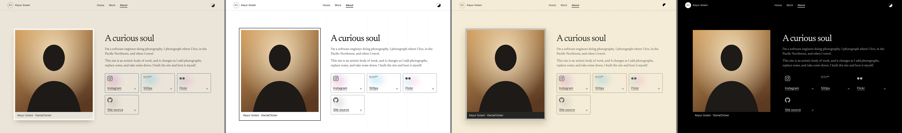

---

## Home

Home plays the featured series in its own order and shows the photograph and nothing else. Move the pointer, tab in, or tap, and the chrome comes back: the navigation and the theme control at the top, the series' title and short statement with Enter the series, and Previous, the position, Next and Play at the bottom. It goes away again after four seconds without activity, and stays while a control has keyboard focus. The slideshow moves on every 12 seconds, and holds still under reduced motion.

**At rest, Dark**

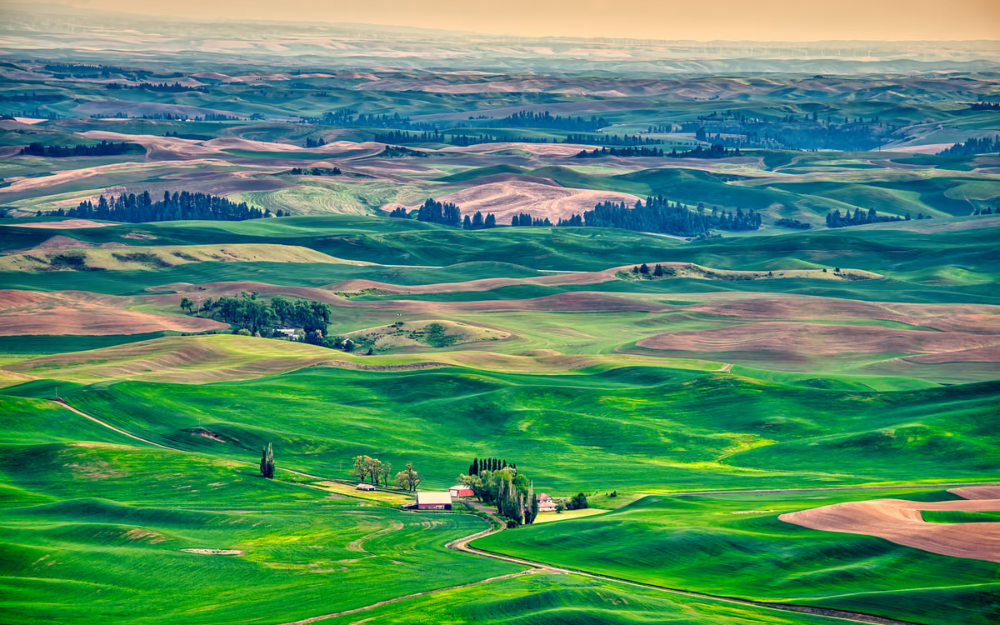

**With the chrome, Dark**

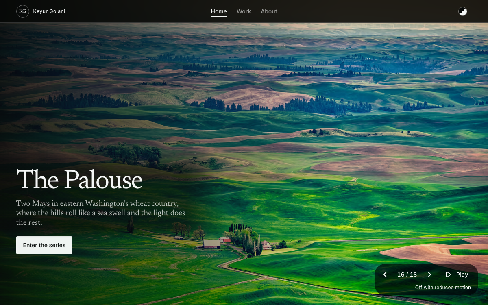

**At rest, Light**

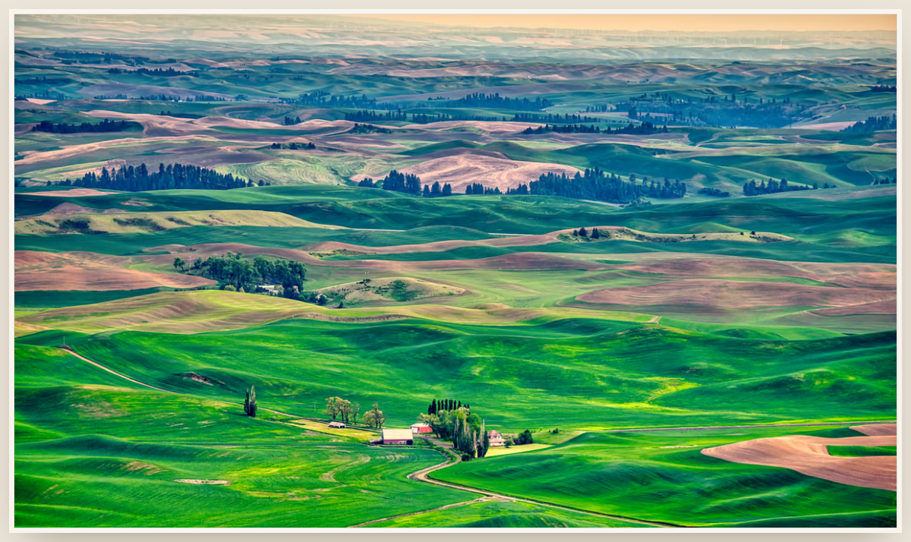

**With the chrome, Light**

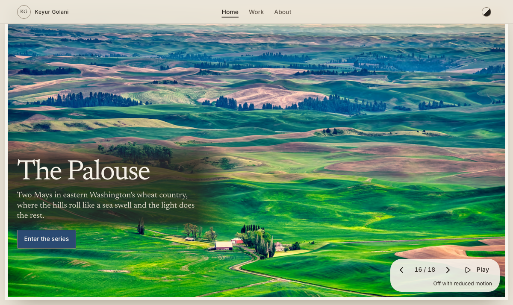

---

## Work

Work is the list of bodies of work, in the order I set. Each series is one link with its cover, its title, a short statement and how many photographs it holds, all there without hovering. The old Gallery address, `/gallery`, now redirects here.

**Dark**

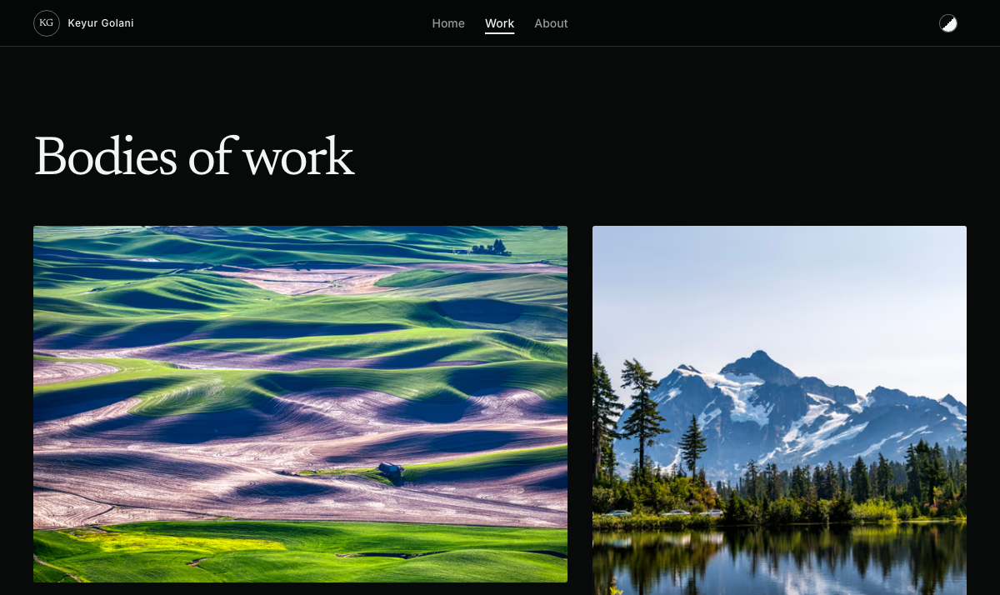

**Light**

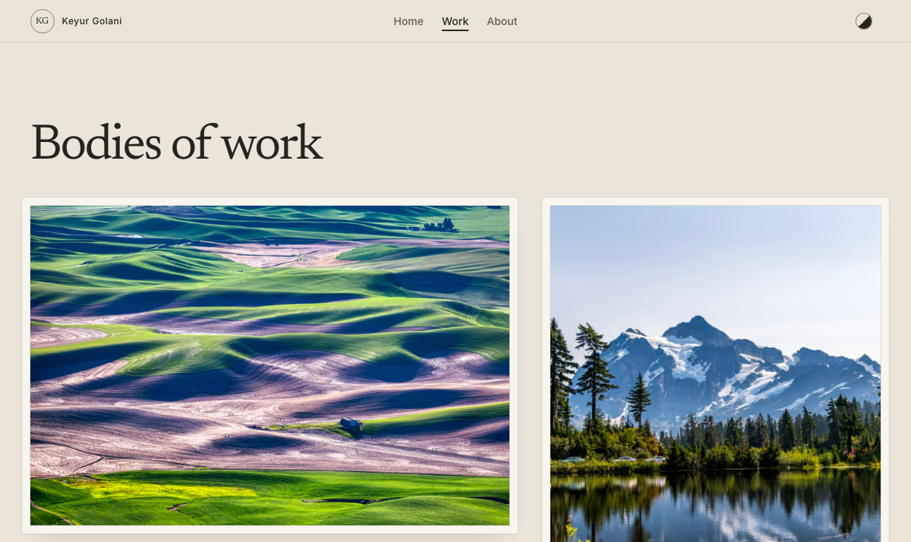

---

## Series pages

A series page opens with its title and my statement for it. Below that are the facts taken from the published photographs: how many there are, the years they were captured, and where, when the records say. Each fact says where it came from, so none of it reads as something I wrote. Then the cover, and the sequence in order, split into its chapters. The sequence shows the first page of photographs, and Show more photographs adds the rest. All work at the end goes back to Work.

**The Palouse, Dark**

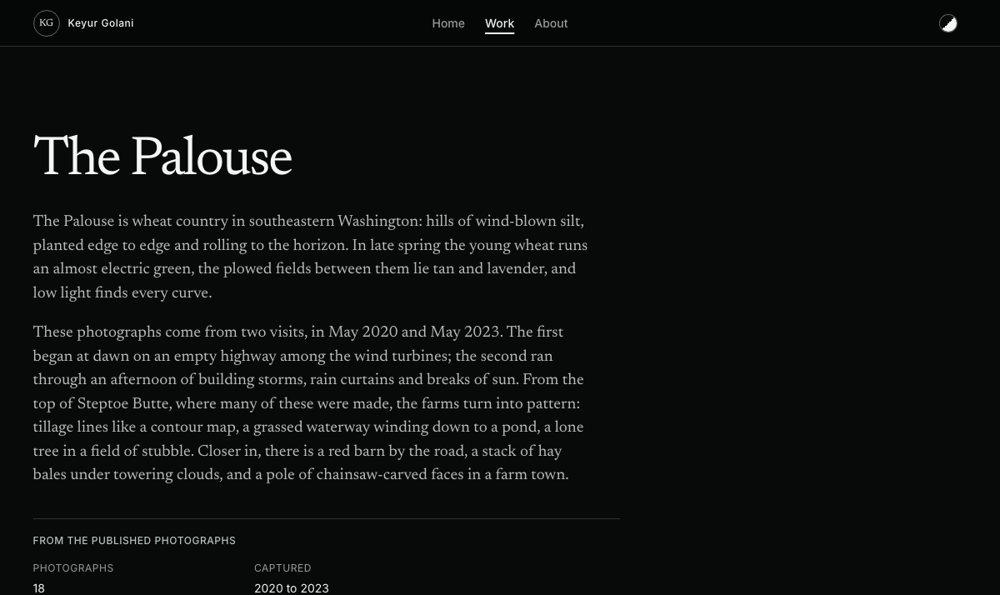

**The Palouse, Light**

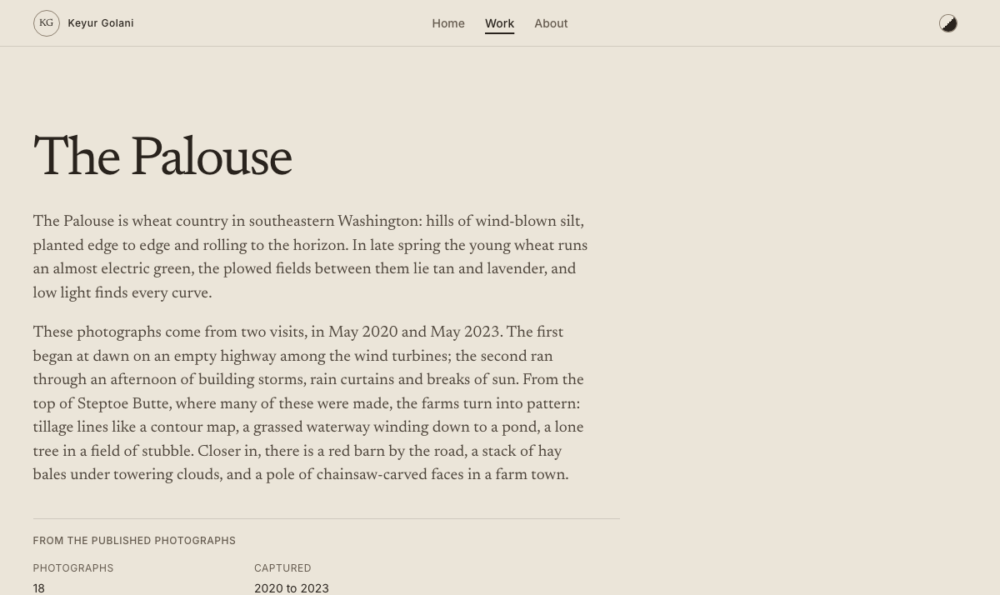

**Its sequence, Dark**

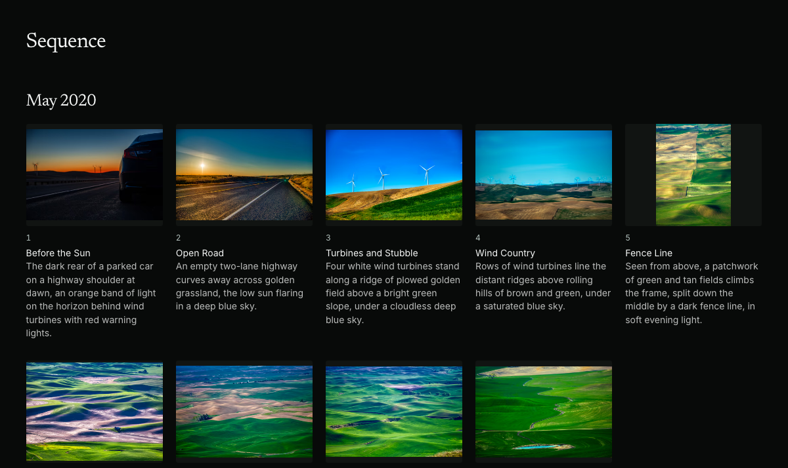

---

## The story Viewer

Any photograph in a sequence opens in the story Viewer, over the series page and at its own address, so it can be shared. It shows the photograph with its title, caption and description, and the camera details read from the file behind a toggle. The arrow keys, a swipe and the side buttons move through the series in order, and it stops at either end instead of wrapping. Zoom or a double tap zooms in. Close puts you back on the photograph you opened in the sequence.

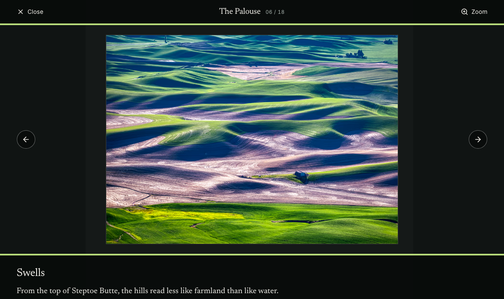

---

## About

About shows the portrait and the name, a short note, and links to my photography profiles and the site's source. Each link lights up in its brand's color on hover or keyboard focus.

---

## At a glance

| | |
|---|---|
| **Framework** | Next.js 16 (App Router) and React 19, in TypeScript |
| **Catalog** | Series published as one revision at a time; `/api/ready` reports the mode and the revision being served |
| **Themes** | System, Light, Bright, Dark and Black, kept per browser and painted before the first frame |
| **Images** | Sharp derivatives at 400, 800, 1200 and 1920 px in AVIF and WebP, with camera details read from the file |
| **Accessibility** | Keyboard, screen reader and touch on every page, to the rules in [docs/accessibility-contract.md](docs/accessibility-contract.md) |
| **Deployment** | Docker, with a background watcher that builds new photographs as they land in the library |

---

_Screenshots from the live site at v1.3.0 in catalog mode, revision 1, in Chromium at 1200 px wide with reduced motion, which is why Home's slideshow shows Play. The series shown is The Palouse. About's use a stand-in portrait, and Home's are taken without its portrait badge. See the [README](README.md) for setup and configuration._
