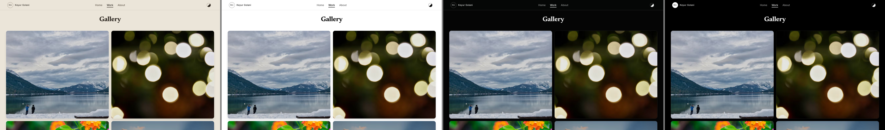
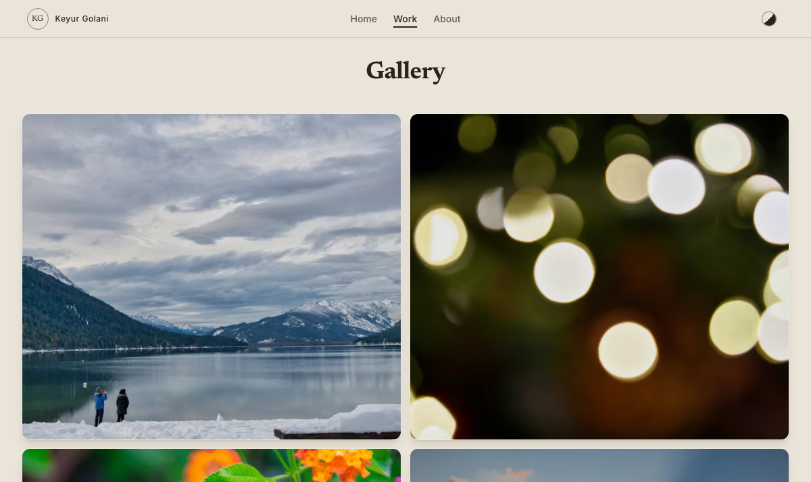
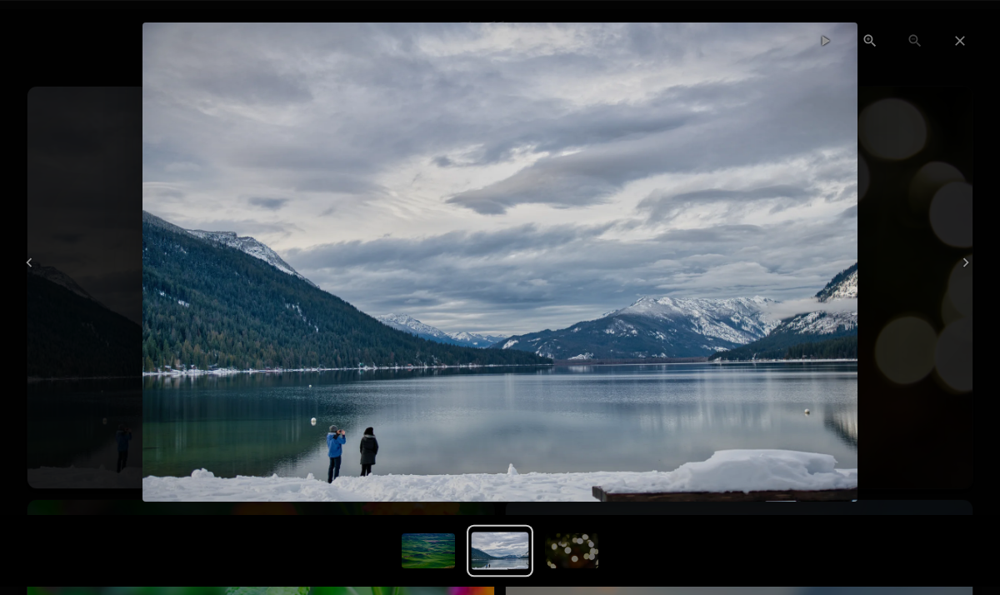

# Showcase

A tour of the site as it's live at v1.3.0. The big change in this release is the themes: five of them, each one a different way to hang the photographs. Home keeps out of the photograph's way, the Gallery holds every photograph, and About says who took them.

---

## Themes

The theme menu, top right on every page, has five choices:

- **System** follows the device, Light or Dark.
- **Light**: soft paper, with the prints matted.
- **Bright**: a white wall, with the prints framed.
- **Dark**: the site as it looked before v1.3.0.
- **Black**: pure black, nothing but the photograph.

The browser keeps the choice, and every page paints in it from the first frame, so there's no flash on load. Without JavaScript the site is Dark and the menu is hidden, since nothing in it could work.

**The Gallery in Light, Bright, Dark and Black**

**About in Light, Bright, Dark and Black**

---

## Home

Home shows the photograph and nothing else. Move the pointer, tab in, or tap, and the chrome comes back: the navigation and the theme control at the top, and Previous, the position, Next and Play at the bottom. It goes away again after four seconds without activity, and stays while a control has keyboard focus. The slideshow moves on every 12 seconds, and holds still under reduced motion.

**At rest, Dark**

**With the chrome, Dark**

**At rest, Light**

**With the chrome, Light**

---

## Gallery

The Gallery holds every photograph in one grid. Each tile takes the photograph's own shape, and the photographs load as you scroll, with a blurred preview until the full image is in.

**Dark**

**Light**

Any photograph opens over the grid, with zoom, a slideshow, and a strip of thumbnails to jump around. The arrow keys and a swipe move through the photographs. Closing it puts you back on the tile you opened.

---

## About

About shows the portrait and the name, a short note, and links to my photography profiles and the site's source. Each link lights up in its brand's color on hover or keyboard focus.

---

## Coming next

Work and the series pages arrive with the catalog launch. Until then, Work in the navigation opens the Gallery.

---

## At a glance

| | |
|---|---|
| **Framework** | Next.js 16 (App Router) and React 19, in TypeScript |
| **Themes** | System, Light, Bright, Dark and Black, kept per browser and painted before the first frame |
| **Images** | Sharp derivatives at 400, 800, 1200 and 1920 px in AVIF and WebP, with camera details read from the file |
| **Accessibility** | Keyboard, screen reader and touch on every page, to the rules in [docs/accessibility-contract.md](docs/accessibility-contract.md) |
| **Deployment** | Docker, with a background watcher that builds new photographs as they land in the library |

---

_Screenshots from the live site at v1.3.0, in Chromium at 1200 px wide with reduced motion, which is why Home's slideshow shows Play. About's use a stand-in portrait, and Home's are taken without its portrait badge. See the [README](README.md) for setup and configuration._
